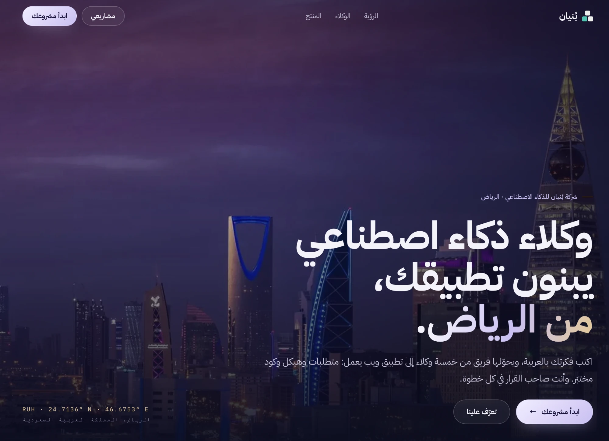
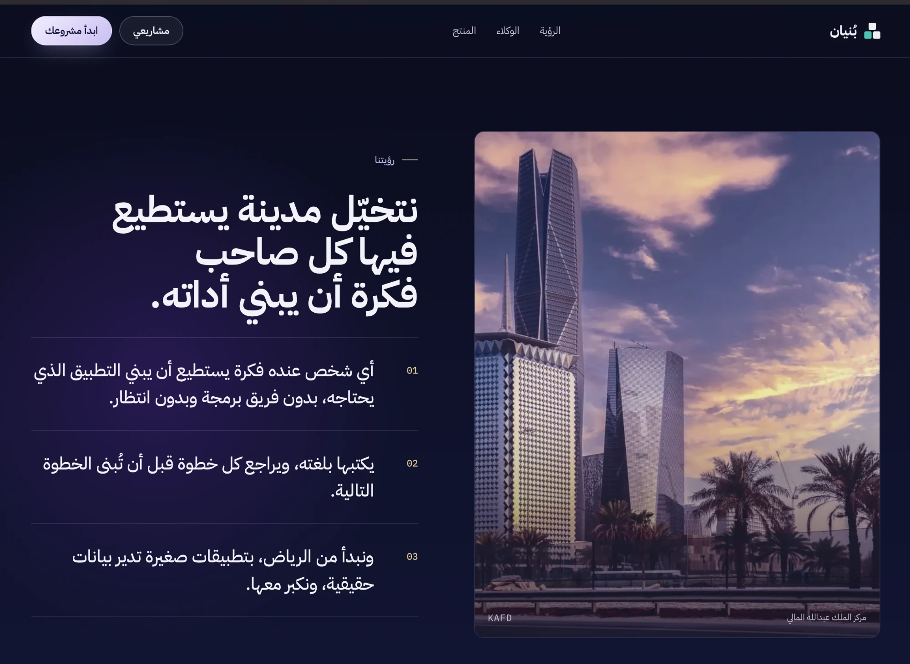
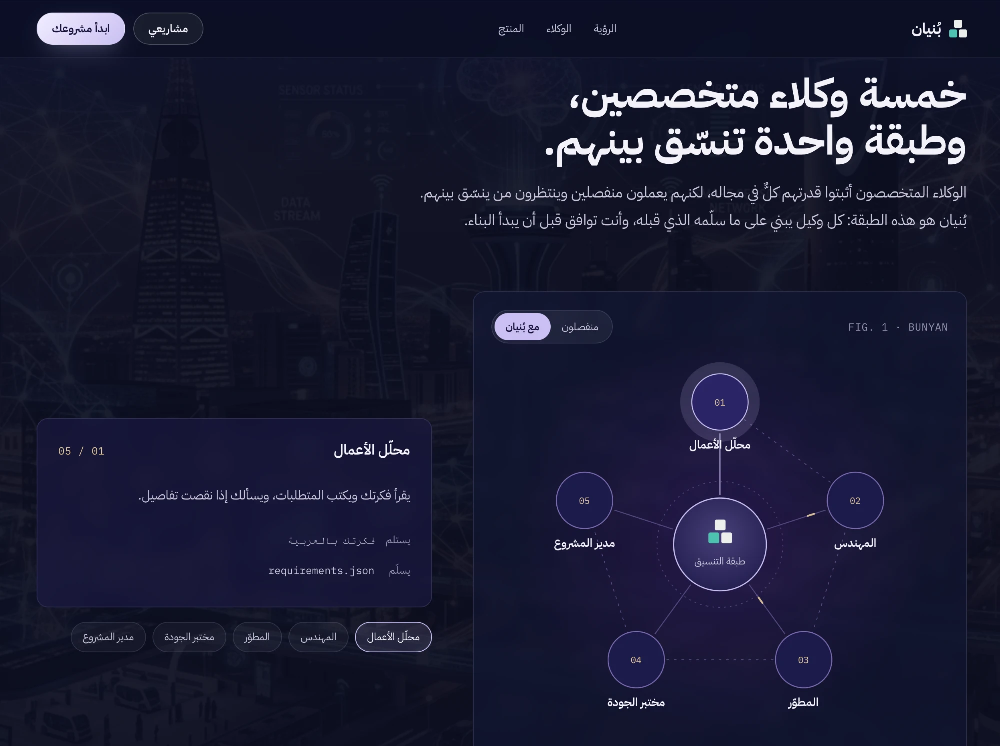
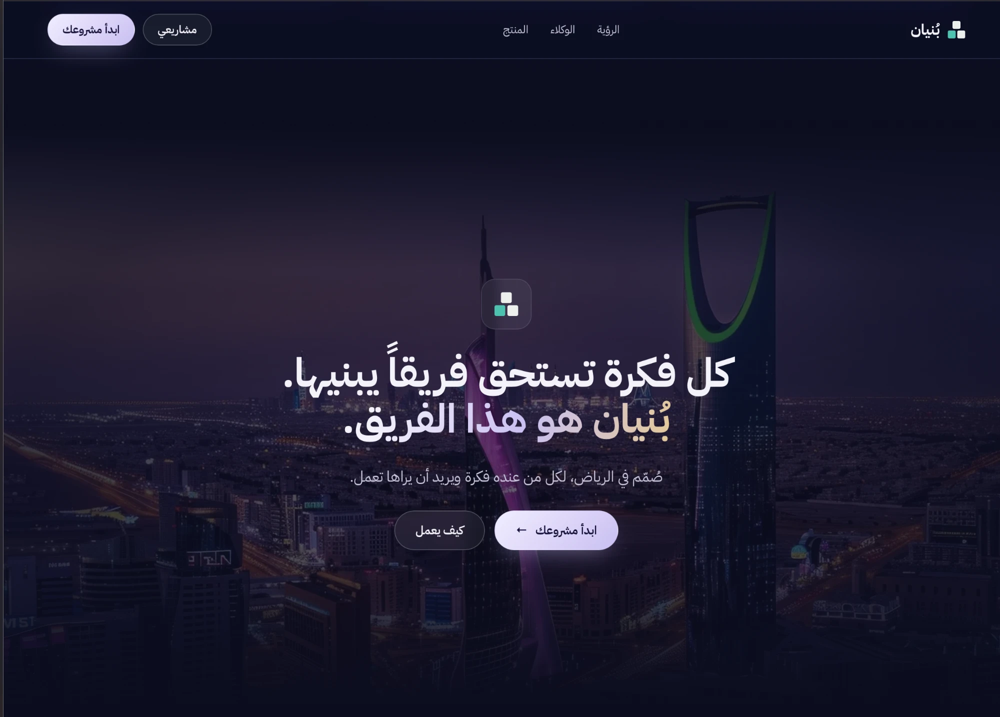

# BUNYAN AI

<p align="center">
  
</p>

<table>
  <tr>
    <td width="33%"></td>
    <td width="33%"></td>
    <td width="33%"></td>
  </tr>
</table>

### Multi-Agent AI Platform for Building CRUD Web Applications

**Tuwaiq Club — King Saud University**

> **Status (November 20, 2026): delivered MVP.** All five agents, the orchestrator, the Riyadh-themed React
> platform and a Docker/Railway deployment are implemented and tested.
>
> **Live demo:** https://bunyan-production-dfa4e72b.up.railway.app (guest access, no login; mock Business Analyst)
>
> Submission package: [docs/SUBMISSION.md](docs/SUBMISSION.md) (what is live, what is only in branches,
> real-LLM evidence, test results, limitations, team contributions, rollback). Arabic user guide:
> [docs/user-guide-ar.md](docs/user-guide-ar.md). Deployment and security: [DEPLOY.md](DEPLOY.md).

---

## Table of Contents

- [Delivery Status](#delivery-status)
- [Introduction](#introduction)
- [Problem Statement](#problem-statement)
- [Proposed Solution](#proposed-solution)
- [Project Objectives](#project-objectives)
- [Target Users](#target-users)
- [Supported Application Types](#supported-application-types)
- [Multi-Agent Architecture](#multi-agent-architecture)
- [Technology Stack](#technology-stack)
- [Repository Structure](#repository-structure)
- [Development Roadmap](#development-roadmap)
- [Team & Contributions](#team--contributions)
- [Getting Started](#getting-started)
- [GitHub Collaboration Guidelines](#github-collaboration-guidelines)
- [Evaluation Criteria](#evaluation-criteria)
- [Security and Limitations](#security-and-limitations)
- [Future Enhancements](#future-enhancements)
- [Additional Documentation](#additional-documentation)

---

## Delivery Status

| Area | State |
|---|---|
| Five agents + orchestrator | Implemented: Business Analyst → user approval → Architect → Developer → QA (real Playwright, Chromium) → Project Manager → preview and ZIP. |
| Business Analyst | Two modes. `mock`: deterministic, recognises only the predefined example ideas (task manager, inventory, appointments/bookings…). `llm`: Claude (`claude-opus-5-5`) through the Anthropic SDK, verified with real paid runs (see [docs/SUBMISSION.md](docs/SUBMISSION.md#real-llm-evidence)). The public demo runs `mock`. |
| Architect, Developer, QA, Project Manager | Deterministic (no LLM): rules, a fixed CRUD template and a fixed 8-check Playwright suite. The PM runs in `mode="rules"`. |
| Automatic repair loop (QA → Developer) | **Live: deterministic, at most 2 repairs** (`BUNYAN_REPAIR=restore`): the Developer restores generated files that differ from the approved contracts and QA re-tests in real Chromium; a repair that changes nothing is not re-tested or claimed. History in `repair_history.json`. **Experimental, off:** an AI repair strategy (`BUNYAN_REPAIR=llm`) that proposes validated, targeted edits for logic defects, only for authorised testers; tested offline and in real Chromium with a stand-in model, not yet with a paid call. See [docs/AI-RELEASE-PLAN.md](docs/AI-RELEASE-PLAN.md). |
| Protected real Business Analyst | Implemented, **off in production**: `BUNYAN_LLM_ACCESS=codes` keeps guests on mock; an access code unlocks Claude for one session, with per-code, site-wide, concurrency and daily limits, and a **cumulative experiment budget** (`BUNYAN_TOTAL_LLM_BUDGET_USD`, never reset, fail closed), all checked before each request. Settings and staged release awaiting approval: [docs/AI-RELEASE-PLAN.md](docs/AI-RELEASE-PLAN.md). |
| Platform | React (Vite) with the Riyadh theme (light/dark, RTL/LTR, desktop/mobile), FastAPI backend. |
| Deployment | One Docker image; live on Railway in guest mode with signed sessions, per-owner isolation, quotas and a sandboxed preview. |

---

## Introduction

**BUNYAN AI** (بنيان — "structure" or "building") is a multi-agent AI platform that turns a natural-language description of a web application into a working **CRUD** (Create, Read, Update, Delete) web application.

A user describes the application they want — for example, *"a simple inventory tracker for a small shop"* — and five specialized AI agents collaborate through a structured software development workflow, similar to a real software team:

1. A **Business Analyst** clarifies the idea and writes requirements.
2. A **Software Architect** designs the application structure and data schema.
3. A **Developer** generates the application source code.
4. A **QA Tester** runs automated browser tests and reports defects.
5. A **Project Manager** produces the project plan, timeline, and risk report.

The result is a previewable, downloadable web application together with its requirements, architecture, test results, and project documentation.

The project is developed over **four weeks** by a **six-member team** at Tuwaiq Club, King Saud University.

---

## Problem Statement

Building even a simple software application involves challenges that slow down individuals and small teams:

- **Requirement misunderstandings.** Ideas are often described informally. Gaps and ambiguities between what a stakeholder means and what is built are frequently discovered only after implementation has started.
- **Development complexity.** Turning an idea into working software requires knowledge of requirements analysis, design, programming, and testing — skills that are not always available within one person or a small team.
- **Documentation overhead.** Requirements, architecture notes, test reports, and project plans take significant effort to produce and are often skipped or left outdated.
- **Late discovery of software defects.** When testing happens late, defects are more expensive and disruptive to fix.
- **Limited development resources.** Startups, small organizations, and students often lack the budget or staff to build prototypes quickly, even for straightforward data-management applications.

---

## Proposed Solution

BUNYAN AI automates a structured, end-to-end software development workflow using **five specialized AI agents**, each responsible for one phase of the process. Each agent receives well-defined inputs, produces a well-defined artifact (JSON, Markdown, or source code), and passes it to the next agent.

Key characteristics of the solution:

- **Structured workflow.** Agents follow a fixed sequence that mirrors a real development lifecycle: analysis → design → implementation → testing → project management.
- **Human in the loop.** The user reviews and approves the generated requirements before any design or code is produced.
- **Shared JSON contracts.** Agents communicate through agreed-upon JSON schemas, making outputs predictable and testable.
- **Automated quality assurance.** Generated applications are tested in a real browser with Playwright; the actual results, including failures, are reported to the user and the Project Manager. Failures go back to the Developer for a deterministic repair (at most two), and QA re-tests after each real change.
- **Complete deliverables.** Alongside the code, the user receives requirements, architecture, test results, a project plan, and a risk report.
- **Focused scope.** The MVP targets CRUD web applications only, which keeps generation reliable and results verifiable.

---

## Project Objectives

By the end of the four-week MVP, the team aims to:

1. **Generate a working CRUD web application** (HTML, CSS, JavaScript with localStorage) from a natural-language description, with all four operations — Create, Read, Update, Delete — functioning in the browser.
2. **Produce structured requirements** (`requirements.json`) containing entities, attributes, functional requirements, user stories, and acceptance criteria.
3. **Produce an architecture specification** (`architecture.json`) describing screens, components, data schema, and navigation.
4. **Run automated functional tests** with Playwright against every generated application and produce an actual test report (`test_report.json`).
5. **Automatically attempt to repair failed tests**, at most two Developer–QA iterations (deterministic strategy; see below).
6. **Generate project documentation** — a project plan (`project_plan.md`) and a risk report (`risks.md`).
7. **Provide a live preview and a downloadable package** of the generated application and all artifacts.
8. **Demonstrate successful generation across several different CRUD scenarios** (for example: task manager, appointment booking, inventory tracker, order manager) during final evaluation.

---

## Target Users

- **Students and developers** who want to quickly scaffold and study a working CRUD application.
- **Entrepreneurs** who want to validate an idea with a functional prototype.
- **Startups** that need early prototypes without dedicating full development resources.
- **Small businesses** that need simple data-management tools.
- **Teams prototyping simple CRUD applications** before committing to a full implementation.

---

## Supported Application Types

The MVP focuses **exclusively on CRUD web applications** — applications whose core purpose is to create, view, edit, and delete records.

### Examples of supported applications

| Application | Example entity | Example attributes |
|---|---|---|
| Task management | Task | title, description, due date, status |
| Simple appointment booking | Appointment | client name, date, time, notes |
| Inventory tracking | Item | name, SKU, quantity, price |
| Basic order management | Order | customer, product, quantity, status |

### Technical characteristics of generated applications

- Built with **HTML, CSS, and vanilla JavaScript**.
- Data persisted in the browser using **localStorage**.
- Single-page, client-side applications that run without a server.
- Include input validation and basic navigation between screens.

### Limitations and excluded features (MVP)

The following are **out of scope** for the MVP:

- Mobile (native) applications.
- Payment processing.
- Enterprise systems (ERP, CRM, etc.).
- Complex or custom backend generation, server-side databases, or APIs in the generated apps.
- User authentication and authorization in the generated apps.
- Real-time collaboration or multi-user data sharing.
- Deployment of generated applications to hosting providers.

Because data is stored in localStorage, it is local to a single browser and is not shared across devices or users.

---

## Multi-Agent Architecture

### Workflow

```
User Idea
   │
   ▼
Business Analyst Agent ──► requirements.json
   │
   ▼
User Approval  (user reviews and approves requirements)
   │
   ▼
Software Architect Agent ──► architecture.json
   │
   ▼
Developer Agent ──► index.html, style.css, app.js
   │        ▲
   ▼        │  real defects (max 2 deterministic repairs, re-test after each real change)
QA Tester Agent ──► test_report.json   (real Chromium, 8 fixed checks)
   │
   ▼
Project Manager Agent ──► project_plan.md, risks.md
   │
   ▼
Preview & Download
```

**In short:** User Idea → Business Analyst → User Approval → Software Architect → Developer → QA Tester → Project Manager → Preview & Download

### Agents

| # | Agent | Owner | Inputs | Outputs |
|---|---|---|---|---|
| 1 | Business Analyst | Ghala Alshreef | User idea, user answers to clarification questions | `requirements.json` |
| 2 | Software Architect | Naifah | Approved `requirements.json` | `architecture.json` |
| 3 | Developer | Yara | `requirements.json`, `architecture.json`, CRUD template, QA feedback | `index.html`, `style.css`, `app.js` |
| 4 | QA Tester | Sara | Acceptance criteria, generated application | `test_report.json` |
| 5 | Project Manager | Jood | Outputs and status from all agents | `project_plan.md`, `risks.md` |

#### 1. Business Analyst Agent

- Understands the user's application idea.
- Asks clarification questions when the idea is ambiguous.
- Identifies entities and their attributes.
- Defines functional requirements.
- Generates user stories and acceptance criteria.
- Ensures the request stays within the CRUD scope.

#### 2. Software Architect Agent

- Receives the approved requirements.
- Defines the application structure.
- Identifies required screens and components.
- Defines the data schema.
- Designs basic application behavior and navigation.
- Ensures compatibility with the CRUD application template.

#### 3. Developer Agent

- Receives the requirements and architecture.
- Generates functional HTML, CSS, and JavaScript.
- Implements Create, Read, Update, and Delete operations.
- Implements input validation.
- Implements localStorage persistence.
- Repairs the app after a QA failure by restoring every generated file that differs from the approved contracts (deterministic; see below).

#### 4. QA Tester Agent

- Generates tests from the approved acceptance criteria.
- Executes automated browser tests using Playwright.
- Verifies all four CRUD operations.
- Identifies functional defects.
- Produces actual test results and failure reports.
- Records each failed check with its real error message for the Project Manager and the user.

#### 5. Project Manager Agent

- Tracks the application generation workflow.
- Collects outputs from the other agents.
- Generates a project plan and a basic timeline.
- Identifies risks and issues.
- Summarizes project status and deliverables.

### Error-Correction Loop (QA ↔ Developer)

1. QA runs the 8 checks in Chromium (attempt 0).
2. If checks fail, the Developer gets the real defects and repairs (`restore_from_contracts`):
   it rebuilds the app the approved `requirements.json` and `architecture.json` describe and replaces
   every generated file that differs (with SHA-256 before/after in the history).
3. Only if a file changed, QA re-tests (attempt 1, then 2). At most **two** repairs.
4. The loop stops when QA passes, the repair changes nothing (no re-test, no repair claimed), the repair
   output is invalid, QA is blocked, or the budget is used. The real final report is kept, the first
   failing one is saved as `test_report.initial.json`, and `repair_history.json` lists every step.
5. Jood's Project Manager reports the attempts and files changed; the Tests view shows the history.

The strategy is deterministic and free: it repairs damaged, edited or stale generated code, not a logic
error in the template itself. An LLM-based code repair is **not implemented**. `BUNYAN_REPAIR=off`
disables the loop.

### Orchestration

The five agents are coordinated by a Python orchestrator (`backend/orchestrator/pipeline.py`) behind the **FastAPI** backend. It keeps the workflow state (`analyzing → awaiting_approval` or `awaiting_clarification` or `rejected`, then after approval `designing → developing → testing → documenting → completed`, or `failed` with an honest reason), passes the JSON contracts between agents, pauses for user approval and stores every artifact. The Business Analyst's LLM mode supports two backends: CrewAI (`BA_LLM_BACKEND=crewai`) and the Anthropic SDK directly (`BA_LLM_BACKEND=direct`), which is what the Docker image and the verified paid runs use. See [docs/architecture.md](docs/architecture.md) and [docs/SUBMISSION.md](docs/SUBMISSION.md).

---

## Technology Stack

| Layer | Technology | Role |
|---|---|---|
| Frontend | **React** | User interface for entering ideas, approving requirements, tracking progress, previewing, and downloading results. |
| Backend | **Python + FastAPI** | REST API that receives requests, runs the agent workflow, and serves artifacts. |
| Orchestration | **Python pipeline** (CrewAI optional for the BA) | Runs the five agents in order and records the state. |
| Language model | **Claude `claude-opus-5-5`** (Anthropic API) | Used by the Business Analyst in `llm` mode only. The other four agents are deterministic. |
| Deployment | **Docker**, **Railway** | One image with the frontend, backend, Node.js and Chromium. |
| Generated applications | **HTML, CSS, JavaScript** | The output web applications, built from a reusable CRUD template. |
| Generated app storage | **localStorage** | Client-side persistence for generated applications — no server or database required. |
| Testing | **Playwright** | Automated browser testing of generated applications and end-to-end testing of the platform. |
| Version control | **Git + GitHub** | Source control, branching, pull requests, code review, and (later) GitHub Actions. |

### About the language models

BUNYAN AI uses **pretrained large language models accessed through provider APIs** (such as OpenAI GPT or Anthropic Claude). The project **does not** train a custom language model and **does not** require collecting a large training dataset. The team's work focuses on agent design, prompt engineering, structured output contracts, orchestration, code templating, and automated testing.

---

## Repository Structure

```
bunyan-ai/
│
├── README.md                     # Project overview (this file)
├── .gitignore                    # Files and folders excluded from Git
├── .env.example                  # Environment variable names (no real values)
│
├── frontend/                     # React user interface
│   └── README.md
│
├── backend/                      # Python + FastAPI backend
│   ├── README.md
│   ├── agents/                   # The five CrewAI agent definitions
│   │   └── README.md
│   ├── schemas/                  # Shared JSON contracts between agents
│   │   └── README.md
│   └── orchestrator/             # Workflow state and agent coordination
│       └── README.md
│
├── templates/
│   └── crud/                     # Reusable CRUD application template
│       └── README.md
│
├── tests/
│   └── e2e/                      # Playwright end-to-end tests
│       └── README.md
│
├── docs/                         # Project documentation
│   ├── architecture.md
│   ├── team-roles.md
│   ├── development-plan.md
│   └── github-workflow.md
│
└── .github/
    └── PULL_REQUEST_TEMPLATE.md  # Default pull request description
```

| Directory | Purpose | Primary owner |
|---|---|---|
| `frontend/` | React application: idea input, requirement approval, progress tracking, preview, download, project dashboard. | Jood, Naifah |
| `backend/` | FastAPI application, API endpoints, configuration. | Alanoud |
| `backend/agents/` | Definitions, prompts, and tasks for the five agents (one module per agent). | Each agent's owner |
| `backend/schemas/` | Shared JSON schemas: `requirements`, `architecture`, `test_report`, etc. | Agreed by the whole team |
| `backend/orchestrator/` | Pipeline, workflow state, agent hand-offs. | Alanoud, Ghala (integration) |
| `templates/crud/` | The reusable HTML/CSS/JS CRUD template used by the Developer Agent. | Yara |
| `tests/e2e/` | Playwright tests for generated apps and for the platform. | Sara |
| `docs/` | Architecture, roles, plan, and collaboration guides. | Ghala (coordination), all members |

---

## Development Roadmap

### Week 1: Foundation

- Repository and collaboration setup.
- Shared JSON contracts.
- Initial agent definitions.
- CRUD template prototype.
- Frontend wireframes.
- Backend skeleton.

### Week 2: Core Integration

- Agent orchestration.
- Working CRUD generation.
- Initial frontend/backend integration.
- Functional testing.

### Week 3: Testing and Improvement

- Automated QA.
- Bug-fixing loop.
- UI enhancements.
- Preview and downloadable artifacts.

### Week 4: Validation and Final Demonstration

- End-to-end tests.
- Evaluation using several CRUD scenarios.
- Performance and reliability improvements.
- Documentation.
- Final demo.

Per-member weekly deliverables are listed in [docs/development-plan.md](docs/development-plan.md).

---

## Team & Contributions

BUNYAN AI was built by a six-member team at Tuwaiq Club, King Saud University. The table shows what each
member delivered. These are verified against the Git history, pull requests and deployments in
[docs/ghala-contribution-audit.md](docs/ghala-contribution-audit.md). The original plan is in
[docs/team-roles.md](docs/team-roles.md).

| Member | Role | Delivered contributions | Pull requests |
|---|---|---|---|
| **Ghala Alshreef** | Founder, project lead, Business Analyst, system integration and delivery | Project definition, scope, architecture and team plan. The Business Analyst agent (mock and real Claude modes, requirements contract, live tests with cost controls). The orchestrator that runs the five agents. Integration of every member's component. Backend API extensions (approval flow, artifacts, preview, ZIP), and the React app connected to the real API. Docker image, Railway deployment, CI. Security and guest access. Production fixes. Final release and documentation. After the release: the deterministic repair loop, protected real-BA access, the integer validation message, an experimental AI repair strategy, and a cumulative AI budget (all paid features off). | [#1](https://github.com/lolo67fa/bunyan-ai/pull/1), [#2](https://github.com/lolo67fa/bunyan-ai/pull/2), [#6](https://github.com/lolo67fa/bunyan-ai/pull/6), [#8](https://github.com/lolo67fa/bunyan-ai/pull/8), [#15](https://github.com/lolo67fa/bunyan-ai/pull/15), [#16](https://github.com/lolo67fa/bunyan-ai/pull/16), [#17](https://github.com/lolo67fa/bunyan-ai/pull/17), [#18](https://github.com/lolo67fa/bunyan-ai/pull/18), [#19](https://github.com/lolo67fa/bunyan-ai/pull/19), [#22](https://github.com/lolo67fa/bunyan-ai/pull/22), [#23](https://github.com/lolo67fa/bunyan-ai/pull/23) |
| **Naifah** | Software Architect Agent | Software Architect agent and the `architecture.json` contract (v0.3.0): screens, fields, input controls, validation rules, per-field messages, verbatim acceptance-criteria texts, display formats. Open for review: the Bunyan identity for generated apps, and frontend fixes from her identity review. | [#4](https://github.com/lolo67fa/bunyan-ai/pull/4); open: [#20](https://github.com/lolo67fa/bunyan-ai/pull/20), [#21](https://github.com/lolo67fa/bunyan-ai/pull/21) |
| **Yara** | Developer Agent | Developer agent and the reusable CRUD template (HTML/CSS/JavaScript, localStorage, validation), with its CI smoke test. | [#10](https://github.com/lolo67fa/bunyan-ai/pull/10) |
| **Sara** | QA Tester Agent | The fixed 8-check Playwright suite, the QA agent (`run_qa`, report validation, quality log) and the `test_report.json` contract (v0.2: verbatim messages, display formats). | [#7](https://github.com/lolo67fa/bunyan-ai/pull/7) |
| **Jood** | Project Manager Agent and frontend | The React frontend, its alignment with the API, the visual identity and the Riyadh theme (landing page and platform), and the Project Manager agent (`project_plan.md`, `risks.md`). | [#3](https://github.com/lolo67fa/bunyan-ai/pull/3), [#9](https://github.com/lolo67fa/bunyan-ai/pull/9), [#11](https://github.com/lolo67fa/bunyan-ai/pull/11), [#12](https://github.com/lolo67fa/bunyan-ai/pull/12), [#13](https://github.com/lolo67fa/bunyan-ai/pull/13), [#14](https://github.com/lolo67fa/bunyan-ai/pull/14) |
| **Alanoud** | Backend API | The FastAPI application, Pydantic API contracts, JSON project storage, the Business Analyst endpoint, input validation and the first CI pipeline. | [#5](https://github.com/lolo67fa/bunyan-ai/pull/5) |

Two responsibilities moved during the project. The orchestrator and most of the backend
integration, first assigned to Alanoud, were delivered by Ghala on top of Alanoud's FastAPI base.
The frontend, first listed under Naifah, was delivered by Jood.

### Ghala Alshreef — Project Lead, Business Analyst & System Integration

Ghala founded the project and led it from the first commit to the production release. Much of the
integration and infrastructure work from November 11 onward was implemented with Claude Code, an AI
coding tool, under her direction. She defined each task, decided scope and trade-offs, approved
merges, deployments and paid model calls, and verified the results. Those commits carry a
`Co-Authored-By` trailer. Evidence for every item: [contribution audit](docs/ghala-contribution-audit.md).

1. **Project leadership and planning.**
   - Created the repository and its foundation documents: problem statement, objectives, CRUD scope and exclusions, the five-agent workflow with a user-approval gate, stack, roadmap, team roles and GitHub rules ([PR #1](https://github.com/lolo67fa/bunyan-ai/pull/1)).
   - Assigned agent ownership.
   - Ran the integration-readiness reviews and made the key decisions: integrating all PRs on one branch, adopting Jood's PM agent, adopting the Riyadh identity.
   - Merged 13 of the 14 merged pull requests.
2. **Business Analyst development.**
   - The agent that turns an idea into a validated `requirements.json`: Pydantic contract, Arabic/English and Gulf-dialect handling, CRUD scope guard, entities, functional requirements, user stories, acceptance criteria, clarification questions and revisions after "request changes".
   - Two modes: deterministic mock, and real Claude (`claude-opus-5-5`) through CrewAI or the Anthropic SDK. One call per analysis, no retries or fallbacks, capped output.
   - 6,414 lines on `main` and 298 tests ([#2](https://github.com/lolo67fa/bunyan-ai/pull/2), [#8](https://github.com/lolo67fa/bunyan-ai/pull/8), [#15](https://github.com/lolo67fa/bunyan-ai/pull/15)).
3. **Multi-agent orchestration.** `backend/orchestrator`:
   - The pipeline from the approved requirements through Architect, Developer, QA and Project Manager, with honest status transitions and error codes.
   - One QA run at a time, evidence storage and outcome classification (passed / failed / blocked / not run).
   - Recovery of interrupted projects ([`15f6b9a`](https://github.com/lolo67fa/bunyan-ai/commit/15f6b9a), [`c097bf8`](https://github.com/lolo67fa/bunyan-ai/commit/c097bf8)).
   - The **deterministic repair loop** (Developer → QA → repair → QA re-test in real Chromium, at most two repairs), using Yara's Developer to rebuild the app from the approved contracts.
     - Only a repair that changed files is re-tested and counted.
     - `repair_history.json` and the first failing report are kept.
     - Jood's PM and the Tests view show the real history.
     - No LLM is used ([`f674274`](https://github.com/lolo67fa/bunyan-ai/commit/f674274), [#17](https://github.com/lolo67fa/bunyan-ai/pull/17)).
   - An experimental **AI repair strategy**, off by default ([`36eec0e`](https://github.com/lolo67fa/bunyan-ai/commit/36eec0e), [#22](https://github.com/lolo67fa/bunyan-ai/pull/22)):
     - restore runs first;
     - then one bounded Claude request, only for testers with an access code;
     - edits are validated (allowlisted files only, no network code, the approved configuration unchanged) before anything is written;
     - real Chromium re-tests the result.
4. **Agent integration.**
   - Integrated PRs #4, #5, #7, #8, #9 and #10 into one working branch and resolved their conflicts.
   - Fixed cross-agent compatibility:
     - Architect mapping of real LLM validation wording, from 7 and 8 unmapped messages to 0.
     - QA receives `architecture.json`.
     - Integer validation: an optional `fields[].messages.invalid` in the Architect contract (v0.3.2, backwards compatible, documented for Naifah), so a fraction in a whole-number field shows the exact message the BA wrote ([`4a9f4fd`](https://github.com/lolo67fa/bunyan-ai/commit/4a9f4fd)).
     - Port and secret isolation for QA.
   - Wrote an interim Project Manager so the pipeline worked end to end.
   - Tested Jood's PM independently, merged it unchanged, then added a separate adapter and accuracy fixes (no invented repairs, real QA messages, every QA state, run time 0) ([`92681fb`](https://github.com/lolo67fa/bunyan-ai/commit/92681fb)).
5. **Backend and frontend integration.**
   - Approval starts generation.
   - Artifact, sandboxed preview and ZIP endpoints ([`9636cc5`](https://github.com/lolo67fa/bunyan-ai/commit/9636cc5)).
   - Connected the React app to the real FastAPI backend with status polling, in Arabic and English ([`a3767a8`](https://github.com/lolo67fa/bunyan-ai/commit/a3767a8)).
   - Real-LLM analysis states and safe error messages in the UI.
6. **Testing and QA integration.**
   - Connected Sara's QA agent to real Playwright runs in the pipeline, including a test that breaks an app on purpose to confirm the suite catches it.
   - Backend test suites (3,346 lines of `tests/`); CI coverage for the pipeline, QA, security and guest mode.
   - A browser journey script used locally, in Docker and on the live site.
   - Acceptance runs in English and Arabic.
7. **Infrastructure and cloud deployment.**
   - One Docker image (React build, FastAPI, Node, Playwright Chromium; non-root, health check, persistent `/data` volume) and a hardened Compose file ([`f895495`](https://github.com/lolo67fa/bunyan-ai/commit/f895495)).
   - The Railway service with its volume, variables and secrets.
   - Every deployment, with a recorded rollback point; the final release of `main` @ `296099e` (deployment `9e873d4b`).
8. **Security and guest access.**
   - Login mode: PBKDF2 logins and per-project ownership (404 for anyone else).
   - Quotas per user, per address and site-wide; a preview isolated by CSP `sandbox`.
   - Guest mode: signed anonymous sessions (HMAC, HttpOnly, Secure, SameSite cookies), Origin checks against cross-site writes, limits on new sessions, and paid analysis blocked for anonymous visitors ([`5c79adb`](https://github.com/lolo67fa/bunyan-ai/commit/5c79adb)).
   - Protected real-BA access (off by default): guests stay on the mock analyst; a hashed access code unlocks Claude for one session.
     - Limits checked before any request: per-code and site-wide daily caps, one request at a time, and a daily USD budget that reserves each request's worst case before sending it.
     - The server refuses to start with retries, fallbacks or a larger output cap ([`e29b106`](https://github.com/lolo67fa/bunyan-ai/commit/e29b106)).
   - A **cumulative experiment budget** for all paid AI ([`563d695`](https://github.com/lolo67fa/bunyan-ai/commit/563d695), [#23](https://github.com/lolo67fa/bunyan-ai/pull/23)):
     - never reset, kept in integer micro-dollars on the volume;
     - the worst case is reserved before each request;
     - fail closed when the ledger is missing or damaged;
     - an admin-only summary.
     - The lead approved $5 in total, including an estimated $1.2919 already spent; it is not active in production.
9. **Production debugging.** Traced a Safari report of raw JSON with garbled Arabic to an HTTP 429 on the homepage in the Railway logs.
   - The fix: the site always loads; only the API needs a new guest.
   - Errors now show as an Arabic page in the site theme; JSON uses UTF-8 ([`858ce45`](https://github.com/lolo67fa/bunyan-ai/commit/858ce45), [`7619e18`](https://github.com/lolo67fa/bunyan-ai/commit/7619e18)).
   - Also fixed QA port collisions in Docker and preview assets blocked by the CSP sandbox.
10. **GitHub and CI workflow.**
    - The manual paid-test workflow with a typed confirmation and cost caps; five real-model runs, each approved and recorded.
    - `ci.yml` extended to the integration and deployment branches.
    - 33 of the 71 CI runs.
11. **Final release and delivery.**
    - The delivery branch, reconciling every team PR (each confirmed fully contained) without rewriting history.
    - The final PR with green CI ([#16](https://github.com/lolo67fa/bunyan-ai/pull/16)).
    - The submission documents ([docs/SUBMISSION.md](docs/SUBMISSION.md), [Arabic user guide](docs/user-guide-ar.md), [DEPLOY.md](DEPLOY.md)).
    - The production release, so that GitHub `main` and Railway run the same code.

---

## Getting Started

**With Docker (recommended for reviewers):**

```bash
git clone https://github.com/lolo67fa/bunyan-ai.git && cd bunyan-ai
cp deploy.env.example deploy.env          # BUNYAN_AUTH=guest and BA_MODE=mock work without any key
# set BUNYAN_SESSION_SECRET in deploy.env to a long random value, e.g. from: openssl rand -hex 32
docker compose up --build -d              # then open http://localhost:8080
```

For plain `http://localhost` also set `BUNYAN_COOKIE_SECURE=false` in `deploy.env`. Details, security
controls and Railway: [DEPLOY.md](DEPLOY.md).

**For development (Python 3.11, Node.js 22):**

```bash
python -m venv .venv && . .venv/bin/activate
pip install fastapi uvicorn httpx pytest -r backend/agents/business_analyst/requirements-direct.txt
(cd tests/e2e && npm ci && npx playwright install chromium)   # the QA agent's browser tests
uvicorn backend.main:app --reload --port 8000                  # BA_MODE=mock by default
(cd frontend && npm ci && npm run dev)                         # http://localhost:5173
```

Tests: `pytest tests backend/agents`, `cd frontend && npm test`. The real Business Analyst needs
`BA_MODE=llm` and `ANTHROPIC_API_KEY` (never commit `.env`).

---

## GitHub Collaboration Guidelines

A beginner-friendly, step-by-step guide is available in [docs/github-workflow.md](docs/github-workflow.md). Summary:

### Feature branches

- Never commit directly to `main`.
- Each member works on her own feature branch:

  | Member | Branch |
  |---|---|
  | Ghala | `feature/ghala-analyst` |
  | Jood | `feature/jood-project-manager` |
  | Yara | `feature/yara-developer` |
  | Sara | `feature/sara-qa` |
  | Naifah | `feature/naifah-architect` |
  | Alanoud | `feature/alanoud-backend` |

- Additional short-lived branches may use `feature/<name>-<topic>`, `fix/<name>-<topic>`, or `docs/<topic>`.

### Issues

- Every task should have a GitHub Issue with a clear title, description, owner, and (if relevant) the week it belongs to.
- Reference issues in commits and pull requests (e.g., `Closes #12`).

### Commits

- Make small, focused commits.
- Use clear, descriptive messages in the imperative mood, e.g. `Add requirements.json schema` or `Fix localStorage update logic`.
- Never commit secrets, `.env` files, `node_modules/`, or virtual environments.

### Pull Requests

- Open a Pull Request into `main` when a piece of work is ready.
- Fill in the [pull request template](.github/PULL_REQUEST_TEMPLATE.md): summary, related issue, files changed, testing performed, integration dependencies.

### Code reviews

- Every PR needs at least **one approving review** from another team member before merging.
- Changes to shared files (`backend/schemas/`, API contracts, `README.md`) should be reviewed by the affected owners.

### Merging into `main`

- Merge only after approval and after resolving all review comments and conflicts.
- The PR author merges after approval unless the team agrees otherwise.
- Delete the feature branch after merging if it is no longer needed.

### Keeping branches synchronized

- Pull the latest `main` regularly and merge it into your feature branch to reduce conflicts:

  ```bash
  git checkout main
  git pull origin main
  git checkout feature/<your-branch>
  git merge main
  ```

### Ownership rules

- Each member implements her own assigned components.
- Avoid modifying files owned by another team member without coordinating first.
- **Shared API contracts and JSON schemas must be agreed upon before implementation.**

---

## Evaluation Criteria

The platform will be evaluated against a set of CRUD scenarios (for example: task manager, appointment booking, inventory tracker, order manager).

| Criterion | What is measured |
|---|---|
| **CRUD correctness** | Whether Create, Read, Update, and Delete each work correctly in the generated application, including persistence after page reload. |
| **Code execution** | Whether the generated application loads and runs in the browser without JavaScript errors. |
| **Test pass rate** | Percentage of Playwright tests that pass, measured both before and after the repair loop. |
| **Requirement satisfaction** | Proportion of acceptance criteria in `requirements.json` that are met by the generated application. |
| **Generation duration** | Total time from approved requirements to final artifacts, and time per agent stage. |
| **Scenario coverage** | Number of distinct CRUD scenarios for which the platform successfully generates a working, tested application. |

Results will be recorded with the actual values measured during Week 4 evaluation; no target figures are assumed in advance.

---

## Security and Limitations

- **API key management.** API keys are provided through environment variables (`.env`), which is excluded from Git. Only variable names are listed in `.env.example`. Keys must never be committed, shared in issues, or exposed to the frontend.
- **Isolated execution of AI-generated code.** Generated applications are untrusted code. They are previewed in a sandboxed environment (e.g., a sandboxed iframe) and tested in isolated Playwright browser contexts, never executed with backend privileges.
- **Synthetic test data.** Testing uses synthetic data only; no real personal or business data is used.
- **Limited automatic repair.** At most two deterministic repairs; nothing is claimed unless files really changed and QA re-tested them.
- **Shared demo controls.** The public demo uses signed anonymous guest sessions, per-owner project isolation, Origin checks, per-guest/per-address/site-wide quotas, a sandboxed preview (CSP `sandbox`) and no paid LLM access. See [DEPLOY.md](DEPLOY.md).
- **LLM output variability.** Language-model output is non-deterministic; results may vary between runs, and generated code should be reviewed before any reuse.
- **Not for production.** BUNYAN AI is an academic prototype. Neither the platform nor the generated applications are intended for production deployment.

---

## Future Enhancements

> The following items are **future work** and are **not** part of the MVP requirements.

- Support for additional web application types beyond CRUD.
- Database-backed generated applications (server-side persistence).
- Authentication and user accounts in generated applications.
- Deployment integrations for publishing generated applications.
- More advanced automated testing (e.g., accessibility, visual regression, performance testing).

---

## Additional Documentation

- [Submission package](docs/SUBMISSION.md)
- [Arabic user guide](docs/user-guide-ar.md)
- [Deployment and security](DEPLOY.md)
- [Secure AI capabilities: settings and staged release](docs/AI-RELEASE-PLAN.md)
- [System Architecture](docs/architecture.md)
- [Team Roles and Ownership](docs/team-roles.md)
- [Four-Week Development Plan](docs/development-plan.md)
- [GitHub Workflow Guide](docs/github-workflow.md)
- [Pull Request Template](.github/PULL_REQUEST_TEMPLATE.md)

---

*BUNYAN AI — Tuwaiq Club, King Saud University.*
